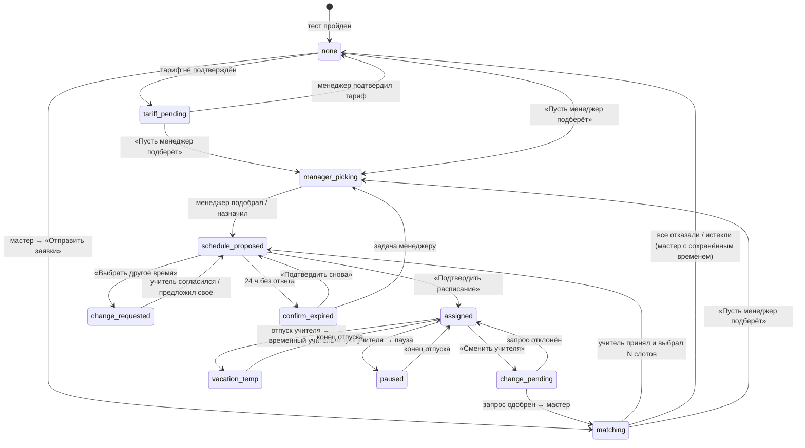

# ТЗ: подбор учителя — сторона студента (ai-tutor)

**Версия:** 1.1 · **Дата:** 25.10.2026 · **Статус:** на согласовании
**Система:** ai-tutor.justtostudy.kz (веб; позже мобильное приложение)
**Прототип:** `student_prototype.html` (в этой же папке)
**Документ самостоятельный:** всё, что нужно фронтенду и бэкенду для студенческой части, описано здесь. Сторона менеджера — `07_TZ_student_i_menedzher.md` §3, сторона учителя — `06_TZ_uchitel_integraciya.md`. Ниже о них — только то, что видит студент.

---

## 0. Цель

После онбординга и теста уровня студент **сам выбирает учителя** за 3 шага: формат → удобное время → учитель. Затем учитель предлагает время уроков, студент **подтверждает расписание**, и уроки появляются в существующем виджете «Расписание» на Главной.

Если выбирать не хочется — кнопка **«Пусть менеджер подберёт»**.

### Решения (кратко)

| # | Решение |
|---|---|
| 1 | Главная **не меняется**. Выбор учителя — последний шаг онбординга и новый пункт меню **«Мой учитель»** |
| 2 | **Тариф** (направление, гарантия, длительность урока 30/60, уроков в неделю) применяется **автоматически** после подтверждения менеджером. Студент его не меняет |
| 3 | Гарантийный тариф, IELTS, SAT — **без шага «Формат»** (формат = программа платформы) |
| 4 | Студент отмечает **все удобные слоты** (сколько угодно), минимум = уроков в неделю и в **разных днях** |
| 5 | Выбор **до 3 учителей** с приоритетом. Заявки уходят всем сразу, со всеми слотами студента |
| 6 | Учитель, принимая заявку, выбирает N слотов → студент **подтверждает расписание** за 24 ч или просит другое время |
| 7 | **«Пусть менеджер подберёт»** — заявка менеджеру, срок 24 рабочих часа |
| 8 | Интересы — **до 5**, по **6 категориям** |
| 9 | Время везде — в **часовом поясе студента** (авто + ручной выбор) |
| 10 | Кнопки **«Написать в чат» нет** |
| 11 | Уведомления: колокольчик (всегда), бейдж на «Мой учитель», всплывающие окна, WhatsApp / Telegram, push — когда выйдет приложение |

### Экраны прототипа

| № | Экран | Где в ai-tutor |
|---|---|---|
| 1 | Онбординг — последний шаг «Выберите своего учителя» (+ состояние «тариф ещё не подтверждён») | после «Результатов теста» |
| 2 | Шаг «Формат обучения» | мастер подбора |
| 3 | Шаг «Удобное время» (много слотов, 30/60 мин, часовой пояс) | мастер подбора |
| 4 | Шаг «Учителя» (фильтры, интересы по категориям, «Подходит ваше время», до 3 с приоритетом) | мастер подбора |
| 5 | Профиль учителя — вид студента (вкладки «Профиль» / «Резюме PDF») | из шага 4 и из «Мой учитель» |
| 6 | «Заявки отправлены» | «Мой учитель» |
| 7 | «Подтвердите расписание» (+ «Выбрать другое время») | всплывающее окно + «Мой учитель» |
| 8 | «Пусть менеджер подберёт» | онбординг, шапка мастера, «Мой учитель» |
| 9 | «Мой учитель»: учитель, расписание, смена формата, смена учителя, отпуск учителя (пауза / временный учитель) | новый пункт меню |
| 10 | Профиль студента: «Мой учитель», «Мои интересы», «Настройки обучения» | ai-tutor → Профиль |
| 11 | Главная — без изменений, уроки в виджете «Расписание» | ai-tutor → Главная |
| 12 | Уведомления, колокольчик, бейджи | везде |

> В прототипе на тёмной полосе сверху есть кнопка **«⚙ Настройки демо»** (тариф, гарантия, длительность, «тариф подтверждён», часовой пояс, отпуск учителя). Это только для показа разных случаев. **Студент этих настроек не видит**, в продукт они не переносятся.

---

## 1. Что есть сейчас → что меняем

| Элемент ai-tutor | Сейчас | Меняем | Флаг |
|---|---|---|---|
| Онбординг | Регистрация → тест → «Результаты теста» → Главная | Новый **последний шаг «Выберите своего учителя»** | `student_matching` |
| Меню слева | Главная, Повторение, Практика, Speaking Buddy, Уроки, Домашняя работа, Словарь, IELTS, SAT, Настройки | Новый пункт **«Мой учитель»** под «Главной», с бейджем-цифрой | `student_matching` |
| Главная | Прогресс к цели, результаты теста, задания, сильные/слабые стороны, практика, виджет «Расписание», «Домашнее задание» | **Без изменений.** Уроки с учителем появляются в виджете «Расписание» | — |
| Профиль | Обложка, уровень, «дней подряд», «уроков пройдено», навыки, уровень английского, персонализация, настройки, выход | Новые блоки: **«Мой учитель»**, **«Мои интересы»**, **«Настройки обучения»** (§2.10). Существующие блоки не трогаем | `student_matching` |
| Настройки | Язык, уведомления (вкл/выкл) | **Часовой пояс** (авто + ручной), **каналы уведомлений** WhatsApp / Telegram / приложение («скоро») | `student_matching` |
| Колокольчик | Есть, со счётчиком | Новые типы уведомлений (§6) | `student_matching` |
| Виджет «Расписание» | Уроки на 7 дней | Уроки с учителем, длительность 30 или 60 мин | `lesson_30` |

---

## 2. Экраны

### 2.1 Онбординг — последний шаг «Выберите своего учителя»

**Когда показывается:** сразу после «Результатов теста», если у студента есть активный абонемент на индивидуальные занятия и нет учителя. Если студент закрыл онбординг раньше — экран доступен через «Мой учитель».

**Состав:**
- прогресс онбординга (все сегменты заполнены), подпись «Шаг 5 из 5»;
- чип «Тест пройден · {уровень}»;
- строка тарифа — **показывается, только чтение** (решение от 25.10, см. §3.0);
- заголовок **«Последний шаг — выберите своего учителя»**;
- подзаголовок «Подберём учителя под ваше время, формат обучения и интересы. Это займёт около 3 минут.» (для гарантии/IELTS/SAT без слов «формат обучения»; для гарантии дописать «По тарифу с гарантией обучение идёт по программе платформы, поэтому выбирать формат не нужно.»);
- 3 факта: «3 шага: Формат → Время → Учитель» (или «2 шага: Время → Учитель»), «До 3 учителей — отправим заявки всем сразу», «Ответ до 12 ч»;
- кнопки: **«Выбрать учителя →»** (основная), **«Пусть менеджер подберёт»**, **«Сделаю позже»**.

#### 2.1.1 Состояния тарифа

| Состояние | Что видит студент | Кнопки |
|---|---|---|
| Тариф подтверждён | Строка «Ваш тариф: General English · уроки по 60 мин · 2 раза в неделю» (+ «· гарантия»). Только чтение | «Выбрать учителя», «Пусть менеджер подберёт», «Сделаю позже» |
| Тариф ещё не подтверждён | Чип «Тариф подтверждает менеджер» + баннер: **«Ваш менеджер подтверждает тариф, обычно до 2 часов.** Мы пришлём уведомление, и можно будет выбрать учителя. Или попросите менеджера подобрать учителя за вас.» | «Выбрать учителя» **неактивна**; «Пусть менеджер подберёт» и «Сделаю позже» активны |
| Нет абонемента на индивидуальные занятия | Экран не показывается; в «Мой учитель» — «Чтобы выбрать учителя, оформите абонемент» | «Связаться с менеджером» |

*Что происходит у менеджера:* в карточке ученика блок «Тариф и подбор», кнопка «Подтвердить тариф ученика» (07_TZ §3.1).

**Тексты:**
- «Сделаю позже» → открывается Главная, тост «Напомним в колокольчике. Выбрать учителя можно в разделе „Мой учитель“». Подпись под кнопками: «Через 24 часа напомним в WhatsApp, через 48 часов подключится менеджер».

**Критерии приёмки:**
- **Given** тариф не подтверждён, **Then** «Выбрать учителя» неактивна, «Пусть менеджер подберёт» активна.
- **Given** менеджер подтвердил тариф, пока студент на экране, **Then** экран обновляется без перезагрузки (WebSocket или опрос раз в 30 с), приходит уведомление «Тариф подтверждён», кнопка становится активной.
- **Given** «Сделаю позже», **Then** на «Мой учитель» бейдж «1», уведомление в колокольчике; через 24 ч напоминание в WhatsApp/Telegram; через 48 ч задача менеджеру.
- **Given** гарантийный тариф или IELTS/SAT, **Then** факт «2 шага: Время → Учитель».

### 2.2 Шаг «Формат обучения»

**Пропускается:** гарантийный тариф, IELTS, SAT (формат = «По программе платформы»).

**Шапка любого шага мастера:**
- «← Назад»;
- шаги «Формат обучения — Время занятий — Выбор учителя» (✓ пройденные, номер текущего), прогресс-бар;
- строка тарифа (**только чтение**, решение от 25.10);
- кнопка **«Пусть менеджер подберёт»** справа.

**Состав:** заголовок «Как вы хотите заниматься?», подзаголовок «Формат можно поменять позже в разделе „Мой учитель“». Три карточки (выбирается одна):

| Формат | Текст на карточке |
|---|---|
| По программе платформы | Уроки, ДЗ и прогресс идут по программе Just to Study. Всё видно в «Уроках» и «Домашней работе». |
| По учебнику | Учитель ведёт по учебнику: English File, Speakout, Headway и др. Учебник согласуете на первом уроке. |
| Материалы учителя | Учитель готовит материалы под ваши цели и интересы: статьи, видео, разговорные темы. |

На каждой карточке подпись «Доступно учителей: N». Кнопка «Дальше: время →» активна после выбора.

**Критерии приёмки:**
- **Given** выбран формат X, **Then** дальше в подборе только учителя, у которых X в «Формат обучения».
- **Given** гарантия / IELTS / SAT, **Then** мастер открывается сразу на шаге «Время», шапка показывает 2 шага.

### 2.3 Шаг «Удобное время» (много слотов)

**Состав:**
- заголовок **«Когда вам удобно заниматься?»**;
- подзаголовок: «Отметьте **всё время, когда можете заниматься**, минимум {N} разных дня. Чем больше отметите, тем больше учителей подойдёт. Точное расписание вы подтвердите после того, как учитель примет заявку.»;
- строка «Уроков в неделю: {N}» и чип «Урок {30|60} мин · по тарифу» — **только чтение, без переключателей**;
- строка «🌍 Время показано по вашему часовому поясу: **{город} (UTC+X)**» со ссылкой «изменить» (ведёт в Настройки);
- **сетка Пн–Вс**, строки — начало урока:
  - тариф 60 мин — каждый час 07:00–22:00;
  - тариф 30 мин — каждые 30 мин (:00 и :30);
- **цифра в ячейке** = сколько учителей свободны в этот слот с учётом длительности урока, формата, направления, уровня, `is_matchable`. 0 — серая ячейка «—», не нажимается;
- цвет: 3+ учителя — насыщенный, 1–2 — светлый, 0 — серый; выбранная — фирменный фиолетовый с «✓»;
- клик выбирает/снимает слот (на десктопе — протяжка мышью по диапазону);
- легенда: «3+ учителя · 1–2 учителя · никого нет · Уроки по {30|60} мин. Время, где у учителя уже стоят уроки, скрыто автоматически.»;
- закреплённая снизу панель: «Отмечено: **{k}** слотов в **{d}** днях» + кнопка **«Показать учителей ({n}) →»**.

**Правило «учитель подходит»:** у учителя свободно не меньше N отмеченных студентом слотов **в разных днях**.

**Валидация:**

| Ситуация | Текст в панели | Кнопка |
|---|---|---|
| Дней с отмеченными слотами < N | «· нужно минимум {N} разных дня» | неактивна |
| Подходит 0 учителей | «На отмеченное время нет учителей. Добавьте ещё времени — подсвечены часы, где учителей больше всего.» + подсветка 10 лучших ячеек + ссылка «Пусть менеджер подберёт» | неактивна |
| Подходит 1–2 | «Подходит {n} учителя. Добавьте ещё времени, чтобы было из кого выбрать.» | активна |

**Критерии приёмки:**
- **Given** тариф 30 мин, **Then** в сетке старты :00 и :30, цифры учитывают только учителей, которые проводят уроки по 30 мин.
- **Given** уроков в неделю 3 и отмечено 5 слотов в 2 днях, **Then** кнопка неактивна, текст «нужно минимум 3 разных дня».
- **Given** студент в Москве (UTC+3), **Then** сетка показана в UTC+3, на сервер слоты уходят в UTC.
- Пересчёт цифр ≤ 300 мс после клика (по предзагруженной матрице или через API с задержкой 200 мс).
- Отмеченные слоты сохраняются в черновике: при возврате в мастер они на месте.

### 2.4 Шаг «Учителя»

**Состав:**
- заголовок **«Выберите до 3 учителей»**, подзаголовок «Отметьте в порядке приоритета. Заявки уйдут всем сразу со всем вашим временем. Учитель выберет {N} удобных слота, а вы подтвердите расписание.»;
- **фильтры** (слева на десктопе, сверху на телефоне):
  - **Ваши интересы** — до 5; выбранные показаны сверху чипами с «✕»; ниже 6 категорий-аккордеонов (одна раскрыта), у категории счётчик выбранных;
  - Возраст учителя: Любой / 20–25 / 26–35 / 35+;
  - Специализация;
  - Опыт от: Любой / 3 лет / 5 лет;
- строка «В выбранное время свободно **{n}** учителей · сортировка: лучшее совпадение»;
- **карточка учителя:**
  - фото, имя, «{N}% совпадение», бейдж «Новый учитель» (если в школе < 3 мес.);
  - «{X} years experience · специализации · с {год} года» (количество текущих учеников **не показываем**);
  - зелёная строка **«Подходит ваше время: Пн 19:00, Ср 19:00, Пт 18:00 (3 из 7)»**;
  - 2 строки «О себе»;
  - интересы-чипы (общие с вашими — зелёные), форматы-чипы;
  - кнопки «Выбрать» / номер приоритета + «Убрать», «Профиль»;
- закреплённая снизу панель: «Выбрано: {k} из 3 · 1. Айгерим · 2. Данияр» + **«Отправить заявки»**.

**Интересы — 6 категорий:**

| Категория | Интересы |
|---|---|
| Кино, музыка и развлечения | Кино и сериалы · Аниме · K-pop · Музыка · Игры · Блогинг и соцсети |
| Спорт и активность | Спорт и фитнес · Футбол · Танцы · Йога и медитация |
| Творчество и стиль | Рисование и дизайн · Фотография · Мода · Кулинария |
| Карьера и технологии | IT и технологии · Бизнес и стартапы |
| Знания и саморазвитие | Книги · Наука · История · Психология |
| Путешествия и природа | Путешествия · Природа и животные |

**Пусто:** «В это время никого с такими фильтрами. Уберите часть интересов или вернитесь и выберите другое время.»

**Критерии приёмки:**
- **Given** выбрано 3 учителя, **When** студент нажимает «Выбрать» у 4-го, **Then** кнопка неактивна, тост «Можно выбрать до 3 учителей. Уберите одного, чтобы добавить другого».
- **Given** выбрано 5 интересов, **When** выбирает 6-й, **Then** тост «Можно выбрать до 5 интересов».
- **Given** «Подходит ваше время: … (k из M)», **Then** k и слоты совпадают с ответом сервера.
- **Given** «Отправить заявки», **Then** экран «Заявки отправлены» (§2.6), интересы сохраняются в профиль студента.

### 2.5 Профиль учителя (вид студента)

Окно на весь экран, сверху вкладки **«Профиль» / «Резюме (PDF)»**, крестик.

**Вкладка «Профиль»** (сверху вниз):
- шапка: обложка в цветах платформы, **крупное фото**, имя, бейджи «{N}% совпадение», «Новый учитель»;
- строка «English teacher · специализации»;
- чипы-факты: опыт, возрастная группа, языки, формат;
- 3 плитки: «в Just to Study с {год}», «посещаемость учеников», «уровни A0–B2» (**плитки «учеников сейчас» нет**);
- зелёный блок **«Почему вам подходит»** (только в мастере): «Свободна в ваше время: …», «Общие интересы: …», «Формат: … ✓», «Уроки: 30 и 60 минут ✓»;
- **«Видео-знакомство» — только если видео есть** (вертикальное 9:16 или горизонтальное); если видео нет, блока нет совсем;
- «Обо мне», «Как проходят мои уроки» (с маскотом);
- интересы (общие подсвечены);
- «Результаты моих студентов» (текст + галерея фото);
- сертификаты — **только название и балл** + «✔ Проверено» (файлы студенту недоступны);
- опыт (таймлайн), образование, языки, «Как я преподаю» (уровни, возраст, фокус, подход);
- закреплённая снизу кнопка **«Выбрать учителя»** / «Убрать из выбранных» с подписью приоритета.

**Вкладка «Резюме (PDF)»:** та же информация в виде резюме, кнопка «Скачать PDF».

**Нигде:** телефона, email и кнопки «Написать в чат».

### 2.6 «Заявки отправлены»

Раздел «Мой учитель», состояние `matching`:
- заголовок «Статус заявок»;
- текст: «Учитель отвечает в течение 12 часов, ночь (23:00–08:00) не считается. Как только учитель примет заявку, он предложит время уроков — вам останется подтвердить.»;
- строки по учителям: номер приоритета, фото, имя, статус:
  - «Ждём ответа · осталось 11 ч» (жёлтый);
  - «Принял — ждём учителя с более высоким приоритетом» (зелёный);
  - «Отклонил» (серый, без причины);
- кнопка «Пусть менеджер подберёт».

**Критерии приёмки:**
- **Given** все учителя отклонили или не ответили, **Then** всплывающее окно «Выбранные учителя не смогли взять вас в это время 😔 Мы уже подобрали других подходящих учителей — выберите новых, это займёт минуту.» + кнопки «Выбрать учителей» (мастер на шаге «Учителя», время сохранено) и «Пусть менеджер подберёт».
- Повторный вход в мастер при активных заявках ведёт на этот экран, а не на шаг 1.

### 2.7 «Подтвердите расписание»

**Когда:** учитель принял заявку и выбрал N слотов, или менеджер подобрал / назначил учителя.

**Где:** всплывающее окно при входе + карточка вверху «Мой учитель» + бейдж «1» на «Мой учитель» + уведомления.

**Состав карточки:**
- метка «Учитель принял заявку» или «Менеджер подобрал учителя», подпись «подтвердите в течение 24 ч»;
- фото, имя, специализации, ссылка «профиль»;
- заголовок **«Подтвердите расписание»**;
- строки слотов: «Пн 19:00 — каждую неделю · 60 мин»;
- «Первый урок: **пн 19:00, 02.11** · {часовой пояс}»;
- таймер: «Подтвердите до 26.10, 18:40. До этого времени учитель держит эти часы для вас.»;
- кнопки **«Подтвердить расписание»** и **«Выбрать другое время»**.

**«Выбрать другое время»:**
- текст «Выберите {N} слота в разных днях из времени, когда свободен учитель»;
- чипы **общих слотов** (удобное время студента ∩ окошки учителя), предложенные учителем — уже выбраны;
- кнопки «Отправить учителю на согласование» (активна при ровно N слотах в разных днях) и «Отмена»;
- после отправки: «Учитель согласует новое время до {дата время}» (12 ч);
- если общих слотов меньше N: «Других общих часов нет. Можно добавить удобное время или выбрать другого учителя» + «Добавить время» / «Пусть менеджер подберёт».

**Сроки:**

| Событие | Когда | Что происходит |
|---|---|---|
| Ожидание подтверждения | до 24 ч | слоты учителя закреплены за студентом |
| Напоминание | через 12 ч | «⏰ Осталось {N} ч, чтобы подтвердить расписание…» |
| Истекло | 24 ч | закрепление снято; окно «Время с {учитель} больше не закреплено. Если оно ещё свободно — подтвердите снова, или выберите другое время» (кнопки «Подтвердить снова» — если слоты свободны, «Другое время»); менеджеру задача |

**После «Подтвердить»:**
- окно «🎉 Ваш учитель — {учитель}! Занятия: {слоты}. Первый урок: {дата}, {время} (по вашему времени)»;
- уроки создаются на 4 недели вперёд (дальше — существующая логика продления), первый урок не раньше чем через 24 ч;
- уроки видны в виджете «Расписание» на Главной и в «Мой учитель».

*Что происходит у учителя:* выбирает N слотов при «Принять»; получает «Студент предлагает другое время» (06_TZ §2.3).

**Критерии приёмки:**
- **Given** есть предложенное расписание, **When** студент входит в ai-tutor, **Then** всплывающее окно; после закрытия карточка остаётся вверху «Мой учитель», на пункте меню бейдж «1».
- **Given** «Подтвердить», **Then** ≤ 1 мин уроки нужной длительности видны в «Расписании»; двойной клик не создаёт дублей.
- **Given** «Выбрать другое время», **Then** доступны только общие слоты, ровно N в разных днях; старые слоты остаются закреплены до ответа учителя.
- **Given** 24 ч без ответа, **Then** закрепление снято, окно «Время больше не закреплено».

### 2.8 «Пусть менеджер подберёт»

**Где кнопка:** последний шаг онбординга; шапка каждого шага мастера; «Мой учитель» (когда учителя нет, при ожидании ответов, когда все отказали); экран «0 учителей» на шаге «Время».

**Окно:**
- заголовок «Пусть менеджер подберёт учителя»;
- текст «Менеджер {имя} подберёт учителя под ваше время и интересы, обычно в течение рабочего дня. Потом вам останется подтвердить расписание.»;
- «Удобное время» — отмеченные слоты чипами; если не отмечены: «Не отмечено. Менеджер уточнит при звонке, или отметьте время на шаге „Время“»;
- «Интересы» — из профиля/мастера;
- «Пожелания к учителю» — до 500 символов, плейсхолдер «Например: хочу учителя-мужчину, который готовит к собеседованиям в IT»;
- кнопки «Отмена», **«Отправить менеджеру»**.

**После отправки:** тост «Заявка у менеджера. Ответ до {дата время}»; «Мой учитель» → состояние «Менеджер подбирает учителя до {дата время}», список удобного времени, пожелание цитатой, ссылка «Изменить пожелания». Когда менеджер подобрал — «Подтвердите расписание» (§2.7) с меткой «Менеджер подобрал учителя».

*Что происходит у менеджера:* задача в воронке «Подбор преподавателя», инструмент подбора, кнопки «Отправить учителю» / «Назначить сразу» (07_TZ §3.2). Срок — 24 рабочих часа.

**Критерии приёмки:**
- **Given** у студента активные заявки учителям, **When** «Пусть менеджер подберёт», **Then** подтверждение «Ваши заявки учителям отменятся, подбором займётся менеджер. Продолжить?».
- Пока запрос открыт, кнопка меняется на «Запрос у менеджера · до {дата время}», повторно отправить нельзя.

### 2.9 «Мой учитель»

**Состояния:**

| Состояние | Что показываем |
|---|---|
| Нет учителя | «Подберите своего учителя», шаги, кнопки «Подобрать учителя →» и «Пусть менеджер подберёт» |
| Тариф не подтверждён | «Менеджер подтверждает тариф, обычно до 2 часов» + «Пусть менеджер подберёт» |
| Заявки отправлены | §2.6 |
| Менеджер подбирает | §2.8 |
| Нужно подтвердить расписание | §2.7 вверху |
| Студент предложил другое время | «Учитель согласует новое время до {дата время}» |
| Учитель назначен | см. ниже |
| Отпуск учителя / временный учитель / пауза | баннеры, см. ниже |
| Запрос на смену учителя | «Запрос на смену учителя на рассмотрении. Ответим в течение 24 часов. Занятия с текущим учителем продолжаются» |

**Учитель назначен:**
- карточка: фото, имя, специализации, опыт, «О себе», интересы, кнопка **«Профиль учителя»** (кнопки «Написать в чат» **нет**);
- «Расписание»: слоты с длительностью, часовой пояс;
- «Формат обучения»: текущий формат + **«Сменить формат»** (для гарантийного — пометка «Гарантия» и текст «По тарифу с гарантией результата обучение идёт только по программе платформы», кнопки нет);
- «Что-то не так?»: «Запрос рассмотрят координатор и ваш менеджер, обычно в течение 1 рабочего дня.» + **«Сменить учителя»**.

**Сменить формат** — окно с тремя форматами:
- формат, который учитель ведёт: «Ваш учитель работает в этом формате, смена сразу» → смена, тост «Формат изменён. Учитель получил уведомление»;
- формат, который не ведёт: «Ваш учитель не работает в этом формате, понадобится смена учителя» → поток смены учителя с причиной «Хочу другой формат».

**Сменить учителя** — окно «Почему хотите сменить учителя?»:
- причины (обязательно одна): Не подходит расписание · Не подходит стиль преподавания · Хочу другой формат обучения · Нет прогресса · Не сложился контакт · Жалоба на учителя (опоздания, качество и т.д.);
- комментарий (обязателен для «Жалоба»);
- подпись «Учитель не видит ваше имя в жалобе. До решения занятия идут по расписанию.»;
- «Отправить запрос» → тост «Запрос отправлен. Ответ в течение 1 рабочего дня».
- После одобрения: «Запрос одобрен ✅ Выберите нового учителя — ваши формат и интересы уже сохранены» → мастер (текущий учитель исключён). После нового назначения уроки со старым учителем снимаются.

**Отпуск учителя:**
- баннер «{учитель} в отпуске {дата1}–{дата2}. {k} урока попадают на эти даты.» + кнопка **«Пауза или временный учитель»**;
- окно с двумя вариантами:
  - «⏸ Пауза» — «Уроки переносятся, срок абонемента продлевается на {N} дней» (уроки не списываются);
  - «👩‍🏫 Временный учитель» — «Свободна в ваше время: {учитель} (общие интересы: …). Ещё 2 варианта на выбор. Он(а) видит ваш прогресс и заметки учителя. С {дата} вы автоматически вернётесь к своему учителю.»;
- подпись «Если не выберете до {дата − 2 дня}, ваш менеджер свяжется с вами»;
- после выбора — баннер «Временный учитель {дата1}–{дата2}: {имя}. С {дата3} занятия снова с {учитель}, в прежнее время» или «Пауза {дата1}–{дата2}. Уроки перенесены, срок абонемента продлён на {N} дней».

**Критерии приёмки:**
- Кнопки «Написать в чат» нет ни в одном состоянии.
- **Given** формат сменён менее 30 дней назад, **Then** «Сменить формат» неактивна с подсказкой «Сменить формат можно через {дата}. Если нужно раньше — напишите менеджеру».
- **Given** 2 смены учителя за 90 дней, **Then** «Сменить учителя» открывает текст «Дальнейшая смена — через менеджера» и кнопку «Связаться с менеджером».

### 2.10 Профиль студента

Существующие блоки (обложка, аватар, уровень, «дней подряд», «уроков пройдено», навыки, уровень английского, персонализация, настройки, выход) — **без изменений**. Добавляем после плиток:

- **«Мой учитель»**: статус «Закреплён» / «Не выбран»; учитель, формат, ближайший урок, кнопка «Открыть» — или текст «Выберите учителя: это займёт около 3 минут» + «Выбрать учителя»;
- **«Мои интересы»** ({k} / 5 · по ним подбираем учителя): выбранные чипы с «✕», 6 категорий-аккордеонов — те же, что в мастере;
- **«Настройки обучения»**: часовой пояс (значение + «Расписание показывается в этом времени»), формат обучения, занятий в неделю, уведомления («Платформа, push, WhatsApp» → в Настройки).

### 2.11 Главная

**Без изменений.** После подтверждения расписания уроки с учителем появляются в существующем виджете «Расписание» (день, время, имя учителя, длительность). Новых блоков на Главной нет.

### 2.12 Уведомления и колокольчик

- Колокольчик: новые события (§6), непрочитанные — с точкой.
- Бейдж-цифра на пункте **«Мой учитель»**: есть действие (выбрать учителя, подтвердить расписание, выбрать паузу/замену).
- Всплывающие окна: только для событий, где нужно действие (подтвердить расписание, все отказали, отпуск учителя, запрос одобрен).
- Баннер часового пояса: «Похоже, вы в другом часовом поясе ({tz}). Показывать время по нему?» — «Да / Нет».

---

## 3. Правила

| Тема | Правило |
|---|---|
| Тариф | Направление (General English / Premium / Kids English / IELTS / SAT), гарантия, длительность урока (30/60), уроков в неделю (2/3) подставляются из активного абонемента и **подтверждаются менеджером**. Студент не может их изменить (кнопок нет; API отвечает 403). Пока тариф не подтверждён, самостоятельный выбор учителя закрыт, «Пусть менеджер подберёт» доступна |
| Демо-переключатели | В прототипе тариф, гарантия, длительность, «тариф подтверждён», пояс, отпуск — за кнопкой «⚙ Настройки демо». В продукте их нет |
| Гарантия | Шаг «Формат» пропускается, формат = программа платформы, «Сменить формат» недоступна |
| IELTS / SAT | Шаг «Формат» пропускается, учителя — со специализацией IELTS / SAT |
| Kids English | Мастер проходит родитель под аккаунтом ребёнка; тексты «Интересы ребёнка», «Когда ребёнку удобно»; учителя со специализацией «Kids 7–12» и возрастом «Дети 7–12» |
| Часовой пояс | Определяется по устройству, можно поменять в Настройках. Все экраны — в поясе студента с подписью; на сервер — UTC. Школа работает в UTC+5 (Казахстан) |
| Длительность урока | 60 мин — старты каждый час; 30 мин — каждые 30 мин. Учителя без «Провожу уроки 30 мин» не показываются студентам с 30-мин тарифом |
| Удобное время | Сколько угодно слотов; минимум N разных дней (N = уроков в неделю) |
| Интересы | До 5, из 6 категорий; сохраняются в профиль; используются в сортировке |
| Выбор учителей | До 3, порядок = приоритет. Назначается принявший с самым высоким приоритетом |
| Ответ учителя | 12 ч, ночь 23:00–08:00 не считается |
| Подтверждение расписания | 24 ч, напоминание через 12 ч, слоты закреплены за студентом |
| Другое время | Только из общих слотов, ровно N в разных днях; учитель отвечает 12 ч |
| «Пусть менеджер подберёт» | 24 рабочих часа (пн–сб 09:00–20:00 по Алматы); один открытый запрос |
| Смена формата | Сам, если учитель ведёт формат; иначе через смену учителя. Не чаще 1 раза в 30 дней. Гарантийным — нельзя |
| Смена учителя | Через запрос; решение за 1 рабочий день; не больше 2 смен за 90 дней без менеджера |
| Отпуск учителя | Выбор «Пауза» / «Временный учитель»; пауза не списывает уроки и продлевает абонемент; после отпуска — автоматический возврат |
| Приватность | Студент не видит телефон, email учителя и файлы сертификатов; учитель не видит контакты студента до закрепления |

---

### 3.0 Тариф у студента — только просмотр (решение от 25.10)

| Что видит студент | Где | Можно изменить? |
|---|---|---|
| Направление (General English / Premium / Kids English / IELTS / SAT) | онбординг, шапка мастера, Профиль → «Настройки обучения» | ❌ |
| Гарантия (если есть) | там же | ❌ |
| Длительность урока (30 / 60 мин) | там же + шаг «Время» | ❌ |
| Уроков в неделю (2 / 3) | там же + шаг «Время» | ❌ |

- Никаких переключателей, выпадающих списков и кнопок «Изменить» для этих полей у студента нет — ни в мастере, ни в профиле, ни в настройках.
- Если студент хочет другой тариф или другое число уроков — подсказка: «Чтобы изменить тариф, напишите своему менеджеру» (без кнопки чата, только текст с именем менеджера).
- API: эндпоинты студента получают тариф только на чтение; попытка записать эти поля от имени студента → `403`.
- **Kids English:** отдельного аккаунта родителя нет. Подбор проходит в аккаунте ребёнка — родитель сам или вместе с ребёнком. Тексты: «Интересы ребёнка», «Когда ребёнку удобно заниматься».

## 4. Статусы студента в подборе



| Статус | Название в интерфейсе | Бейдж на «Мой учитель» |
|---|---|---|
| `none` | «Подберите своего учителя» | 1 |
| `tariff_pending` | «Менеджер подтверждает тариф» | — |
| `matching` | «Ждём ответа учителей» | — |
| `manager_picking` | «Менеджер подбирает учителя» | — |
| `schedule_proposed` | «Подтвердите расписание» | 1 |
| `change_requested` | «Учитель согласует новое время» | — |
| `confirm_expired` | «Время больше не закреплено» | 1 |
| `assigned` | «Мой учитель» | — (1 при отпуске без выбора) |
| `change_pending` | «Запрос на смену на рассмотрении» | — |
| `vacation_temp` | «Временный учитель до {дата}» | — |
| `paused` | «Пауза до {дата}» | — |

---

## 5. Данные и API для фронтенда ai-tutor

### 5.1 Данные (то, что читает и пишет студенческий фронт)

```text
student_tariff (только чтение)
  status: pending | confirmed
  direction: general | premium | kids | ielts | sat
  is_guarantee: bool
  lesson_duration: 30 | 60
  lessons_per_week: 2 | 3

student_profile (+)
  interests: string[] (≤ 5, коды из справочника)
  timezone: IANA, напр. "Asia/Almaty"
  notification_channels: [{channel: whatsapp|telegram|push, connected: bool}]

matching_state
  status: none | tariff_pending | matching | manager_picking | schedule_proposed |
          change_requested | confirm_expired | assigned | change_pending | vacation_temp | paused
  format: platform | books | own | null
  student_slots_utc: string[]          -- все отмеченные слоты, начало урока в UTC
  requests: [{teacher, priority, status: waiting|accepted|accepted_waiting|declined|expired, deadline_at}]
  proposal: {id, teacher, by: teacher|manager, slots_utc[], first_lesson_at, expires_at, common_slots_utc[]} | null
  manager_request: {manager_name, wishes, due_at} | null
  assignment: {teacher, slots_utc[], lesson_duration, format, type: permanent|temporary, ends_at} | null
  vacation: {teacher, from, to, choice: null|pause|temp, choose_until} | null
  change_request: {status, reason, created_at} | null
  limits: {format_change_available_at, teacher_changes_left_90d}
```

### 5.2 API

```text
GET    /api/student/tariff                              -> student_tariff
GET    /api/student/matching/state                      -> matching_state (для «Мой учитель», бейджа, окон)

GET    /api/student/matching/availability-grid          -> {duration, slots: {start_utc: teachers_count}} с учётом формата и направления
          ?format=
POST   /api/student/matching/draft                      -> {format, slots_utc[]} (черновик мастера)
GET    /api/student/matching/teachers                   -> [{id, name, photo, score, matching_slots_utc[], hobbies, formats, ...}]
          ?format=&slots=&interests=&age=&spec=&exp=
GET    /api/student/teachers/{id}/profile               -> данные профиля учителя (без контактов и файлов)
GET    /api/student/teachers/{id}/resume.pdf            -> PDF
POST   /api/student/matching/requests                   -> {teacher_ids[] (≤ 3 по приоритету)}; 409 если tariff_pending
POST   /api/student/matching/proposal/{id}/confirm      -> идемпотентно; создаёт уроки
POST   /api/student/matching/proposal/{id}/change       -> {slots_utc[]} ровно N из common_slots
POST   /api/student/matching/manager-request            -> {slots_utc[], interests[], wishes}
PATCH  /api/student/matching/manager-request            -> {wishes}

POST   /api/student/format                              -> {format}; 409 если учитель не ведёт / лимит / гарантия
POST   /api/student/teacher-change                      -> {reason, comment}
POST   /api/student/vacation-choice                     -> {choice: pause|temp, teacher_id?}

PATCH  /api/student/profile                             -> {interests[], timezone}
POST   /api/student/notifications/{channel}/link        -> код или ссылка для WhatsApp / Telegram
```

Ошибки — с понятным текстом для показа: `422 not_enough_days` («Нужно минимум {N} разных дня»), `409 tariff_pending`, `409 slot_taken` («Это время уже заняли, выберите другое»), `409 limit_reached`.

---

## 6. Уведомления студента

Каналы: 🔔 колокольчик · 🔢 бейдж на «Мой учитель» · 🪟 всплывающее окно · 📱 push (когда выйдет приложение) · 💬 WhatsApp / Telegram (если подключены). Тихие часы для 💬 и 📱: 23:00–08:00 по поясу студента, кроме срочных (до конца срока < 2 ч).

| # | Событие | Каналы | Текст | Кнопка |
|---|---|---|---|---|
| 1 | Тест пройден, учитель не выбран | 🔔 🔢 | Подберите своего учителя. Тест пройден — осталось 3 шага, чтобы начать занятия. | Выбрать учителя |
| 2 | Тариф подтверждён | 🔔 💬 📱 | ✅ Ваш тариф подтверждён: {направление}, уроки по {длительность} мин, {частота} раза в неделю. Теперь можно выбрать учителя. | Выбрать учителя |
| 3 | Мастер не завершён 24 ч | 🔔 💬 📱 | Осталось совсем чуть-чуть — выберите учителя, и мы назначим первое занятие. | Продолжить подбор |
| 4 | Заявки отправлены | 🔔 | Заявки отправлены учителям: {список с приоритетом}. Ответ — до {дата} {время}. | Статус подбора |
| 5 | Учитель отклонил (есть ожидающие) | 🔔 | {учитель} не сможет заниматься в выбранное время. Ждём ответа остальных учителей. | Статус подбора |
| 6 | Все отклонили / истекли | 🪟 🔔 🔢 💬 📱 | **Выбранные учителя не смогли взять вас в это время 😔** Мы уже подобрали других подходящих учителей — выберите новых, это займёт минуту. Менеджер {менеджер} тоже на связи. | Выбрать учителей · Пусть менеджер подберёт |
| 7 | Учитель предложил расписание | 🪟 🔔 🔢 💬 📱 | **{учитель} готов(а) заниматься с вами!** Время: {слоты}, уроки по {длительность} мин. Первый урок: {дата}, {время}. Подтвердите до {дата} {время} — до этого времени учитель держит эти часы для вас. | Подтвердить · Выбрать другое время |
| 8 | Напоминание о подтверждении (12 ч) | 🔔 💬 📱 | ⏰ Осталось {N} ч, чтобы подтвердить расписание с {учитель}: {слоты}. Потом время освободится. | Подтвердить |
| 9 | Подтверждение истекло (24 ч) | 🪟 🔔 🔢 💬 | Время с {учитель} больше не закреплено. Если оно ещё свободно — подтвердите снова, или выберите другое время. | Подтвердить снова · Другое время |
| 10 | Учитель предложил другое время | 🪟 🔔 🔢 💬 📱 | {учитель} предлагает другое время: {слоты}. Подтвердите до {дата} {время}. | Подтвердить · Выбрать другое |
| 11 | Расписание подтверждено | 🪟 🔔 💬 📱 | 🎉 **Ваш учитель — {учитель}!** Занятия: {слоты}. Первый урок: {дата}, {время} (по вашему времени). | Мой учитель |
| 12 | Менеджер взял запрос в работу | 🔔 | Менеджер {менеджер} подбирает вам учителя. Ответим до {дата} {время}. | Мой учитель |
| 13 | Менеджер подобрал учителя | 🪟 🔔 🔢 💬 📱 | **Мы подобрали вам учителя — {учитель}!** Время: {слоты}, уроки по {длительность} мин. Посмотрите профиль и подтвердите расписание до {дата} {время}. | Подтвердить · Профиль учителя |
| 14 | Формат изменён | 🔔 | Формат обучения изменён на «{формат}». Учитель уже в курсе. | — |
| 15 | Запрос на смену учителя создан | 🔔 | Запрос на смену учителя отправлен. Ответим в течение 24 часов. Занятия с текущим учителем пока продолжаются. | Статус запроса |
| 16 | Запрос одобрен | 🪟 🔔 🔢 💬 📱 | Запрос одобрен ✅ Выберите нового учителя — ваши формат и интересы уже сохранены. | Выбрать учителя |
| 17 | Запрос отклонён | 🔔 📱 | По вашему запросу на смену учителя: {комментарий менеджера}. | Связаться с менеджером |
| 18 | Отпуск учителя | 🪟 🔔 🔢 💬 📱 | **{учитель} в отпуске с {дата1} по {дата2}.** Как продолжим? ⏸ Пауза — уроки не спишутся, абонемент продлим. 👩‍🏫 Временный учитель — занимаетесь в своё обычное время. | Пауза · Временный учитель |
| 19 | Временный учитель назначен | 🔔 💬 📱 | На период {дата1}–{дата2} вас ведёт {временный учитель}. Он(а) видит ваш прогресс и заметки. С {дата3} вы вернётесь к {учитель}. | Мой учитель |
| 20 | Возврат после отпуска | 🔔 📱 | С возвращением к {учитель}! Занятия снова в обычное время: {слоты}. | — |
| 21 | Другой часовой пояс | баннер | Похоже, вы в другом часовом поясе ({tz}). Показывать время по нему? | Да · Нет |

Для 💬 WhatsApp нужны одобренные Meta шаблоны (события 2, 3, 6, 7, 8, 9, 10, 11, 13, 16, 18, 19) — список и тексты в `03_Uvedomleniya.md`.

---

## 7. Выкатка, оценка, QA, открытые вопросы

### 7.1 Фичефлаги и порядок

| Шаг | Флаг | Что включаем у студента | Условие |
|---|---|---|---|
| 0 | — | Часовой пояс в Настройках и показ времени в поясе студента | без флага, сразу |
| 1 | `tariff_confirm` | Чтение тарифа, состояние «тариф не подтверждён» | менеджерская часть подтверждения тарифа включена |
| 2 | `lesson_30` | Длительность 30 мин в сетке, расписании, карточках | решена ставка учителям за 30 мин |
| 3 | `student_matching` | Последний шаг онбординга, мастер, «Мой учитель», «Подтвердите расписание», профиль студента, уведомления | учительская часть (06_TZ) включена, ≥ 40% активных учителей в подборе |
| 4 | `manager_matching` | «Пусть менеджер подберёт» | можно вместе с шагом 3 |
| 5 | `vacation_flow` | Отпуск учителя: пауза / временный учитель | после 2 недель шага 3 |

Пилот: 20–30 новых студентов General English, 2 недели → все направления.

### 7.2 Оценка (только студенческая часть)

| Задача | FE, дни | BE, дни |
|---|---|---|
| Часовой пояс (настройки, показ, баннер) | 1 | 0.5 |
| Онбординг: последний шаг, состояния тарифа | 1 | 0.5 |
| Мастер: шаг «Формат» + шапка | 0.5 | 0.5 |
| Мастер: шаг «Время» (много слотов, 30/60, цифры, валидация, черновик) | 3 | 2.5 |
| Мастер: шаг «Учителя» (фильтры, интересы по категориям, совпадающие слоты) | 2 | 1.5 |
| Профиль учителя для студента + PDF | 2 | 1 |
| «Заявки отправлены» + «все отказали» | 1 | 0.5 |
| «Подтвердите расписание» + «другое время» + сроки | 2.5 | 3 |
| «Пусть менеджер подберёт» (окно, состояние) | 1 | 1 |
| «Мой учитель»: все состояния, смена формата, смена учителя | 2.5 | 1.5 |
| Отпуск учителя: пауза / временный учитель | 1.5 | 1.5 |
| Профиль студента: новые блоки | 1 | 0.5 |
| Уведомления, бейджи, всплывающие окна, WhatsApp/Telegram у студента | 1 | 1.5 |
| **Итого** | **≈ 20** | **≈ 16** |

QA ≈ 6 дней. Серверная логика подбора, закрепления слотов и уведомлений частично общая с 06_TZ и 07_TZ — при параллельной работе BE-оценка может уменьшиться.

### 7.3 Чек-лист QA

- [ ] Главная не изменилась; уроки с учителем появляются в виджете «Расписание».
- [ ] В меню есть «Мой учитель» с бейджем, когда нужно действие.
- [ ] Онбординг: последний шаг после «Результатов теста»; при неподтверждённом тарифе «Выбрать учителя» неактивна, «Пусть менеджер подберёт» работает.
- [ ] Студент не может изменить тариф (нет элементов в UI, API → 403). Демо-переключателей нет.
- [ ] Гарантия / IELTS / SAT — без шага «Формат»; гарантийному недоступна «Сменить формат».
- [ ] Сетка «Время»: 60 мин — шаг час, 30 мин — шаг 30 мин; цифры учитывают длительность; 0 — не нажимается.
- [ ] Можно отметить сколько угодно слотов; кнопка активна только при N разных днях.
- [ ] Время везде в поясе студента; смена пояса пересчитывает сетку; в запросах — UTC.
- [ ] Интересы: до 5, 6 категорий, сохраняются в профиль, общие подсвечиваются у учителя.
- [ ] «Подходит ваше время: … (k из M)» совпадает с сервером; до 3 учителей с приоритетом.
- [ ] Профиль учителя: нет плитки «учеников сейчас»; видео-блок только при наличии видео; сертификаты — только название и балл; нет контактов и «Написать в чат».
- [ ] «Подтвердите расписание»: окно при входе, карточка в «Мой учитель», бейдж; «Подтвердить» создаёт уроки без дублей; «Другое время» — только общие слоты, ровно N.
- [ ] 12 ч — напоминание; 24 ч — «Время больше не закреплено».
- [ ] «Пусть менеджер подберёт»: окно, отмена активных заявок с подтверждением, один открытый запрос.
- [ ] Смена формата и учителя: ограничения 30 дней / 2 за 90 дней работают.
- [ ] Отпуск: окно выбора, пауза продлевает абонемент, временный учитель с датой возврата.
- [ ] Все уведомления §6 приходят в нужные каналы, тихие часы соблюдаются.
- [ ] Экраны на ширине 360 px; сетка времени скроллится внутри своего блока; страница не уезжает вбок.

### 7.4 Открытые вопросы

1. ~~Показывать ли студенту строку с тарифом?~~ **Решено 25.10:** показываем (студент знает свой тариф), но **ни одного элемента для изменения** тарифа, гарантии, длительности и числа уроков в неделю у студента нет. Меняет только менеджер в карточке ученика.
2. После того как учитель согласился на «другое время», предложенное студентом, — подтверждать автоматически или снова просить подтверждения? Предложение: автоматически.
3. Может ли студент с 30-минутным тарифом выбрать 4–5 уроков в неделю? Сейчас только 2 или 3.
4. Показывать ли студенту метку «Подобрано менеджером»? Сейчас показывается «Менеджер подобрал учителя».
5. ~~Kids: нужен ли отдельный аккаунт родителя?~~ **Решено 25.10:** отдельный аккаунт родителю **не нужен**. Родитель проходит подбор в аккаунте ребёнка (сам или вместе с ребёнком).
6. Сколько недель уроков создавать сразу после подтверждения (сейчас 4)?
